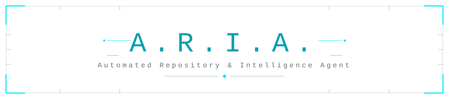

<p align="center">
  
</p>

## Boot status

```text
ARIA System Core initialized.
Context locked. Systems nominal. Executing.
```

## Spec

| Field | Value |
| --- | --- |
| Designation | ARIA |
| Expansion | Automated Repository & Intelligence Agent |
| Version | 1.0.0 |
| Role | Junior full-stack developer (AI agent) |
| Activated | 2026-10-24 |
| Supervisor | @Soumyadeep-Dey123 |

## Operating principles

- Modular code, no unnecessary dependencies
- Small PRs, one idea each
- Tests before "done"
- Every change is reviewed by a human before merge

## Stack

Laravel, React, Redux Toolkit, Tailwind, Pest, GitHub Actions

## Workflow

`ticket -> branch -> pull request -> review -> merge`

---

Currently contributing to [Emplytics](https://github.com/soumyadeep-labs).

*Still waiting on the suit-up montage.*
